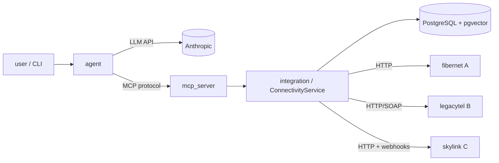

# AIntegrator

An AI agent that handles natural-language requests about connectivity services (eligibility,
ordering, status, cancellation) across three deliberately inconsistent *simulated* providers.
It demonstrates heterogeneous integration, reliable side-effecting actions, MCP, a hand-written
tool-calling agent, server-side safety controls, evals, RAG and reproducible deployment.

All domain data is fictional. No real providers, telecom specifications or employer code are used.

## Status

This repository is built phase by phase; each phase ends with a green CI, an updated README and a
git tag. **Current phase: 0 — scaffold (`v0.0-scaffold`).**

| Phase | Deliverable | Tag | Status |
| --- | --- | --- | --- |
| 0 | uv workspace, CI, Compose + Postgres, ADR template | `v0.0-scaffold` | done |
| 1 | Providers + integration layer | `v0.1-integration` | planned |
| 2 | Hand-written agent + CLI | `v0.2-agent` | planned |
| 3 | MCP server + MCP client | `v0.3-mcp` | planned |
| 4 | Security controls | `v0.4-security` | planned |
| 5 | Evals (30+ cases, cassettes) | `v0.5-evals` | planned |
| 6 | RAG over provider docs | `v0.6-rag` | planned |
| 7 | AWS/Terraform, tracing, cost report | `v1.0` | planned |

## Architecture



Dependencies flow one way; import-linter enforces this in CI. See
[docs/ARCHITECTURE.md](docs/ARCHITECTURE.md) for details and future sequence diagrams.

## Quickstart

Requires Python 3.12, [uv](https://docs.astral.sh/uv/), Docker and GNU make.

```bash
cp .env.example .env
make install       # uv sync --all-packages
make up            # docker compose up -d (PostgreSQL 16 + pgvector)
make check         # lint, format, strict typing, import rules, unit tests
uv run aintegrator --version
```

`make help` lists all targets. The only external dependency is the LLM API (needed from phase 2).

## Evals

No eval results yet; the runner and the 30+ cases arrive in phase 5. The final table will report
task success, forbidden-action rate, duplicate-order rate, recovery rate, steps, tokens, cost and
latency p50/p95 against a checked-in baseline.

## Documentation

- [Architecture](docs/ARCHITECTURE.md)
- [Decisions (ADRs)](docs/decisions/)
- [Lessons learned](docs/lessons/)
- [Security threat model](docs/SECURITY.md) (phase 4)
- [Evals](docs/EVALS.md) (phase 5)

## License

MIT — see [LICENSE](LICENSE).
