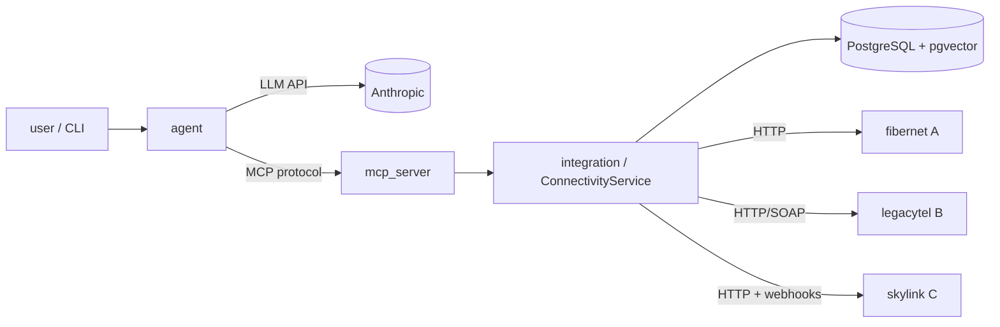

# AIntegrator

An AI agent that handles natural-language requests about connectivity services (eligibility,
ordering, status, cancellation) across three deliberately inconsistent *simulated* providers.
It demonstrates heterogeneous integration, reliable side-effecting actions, MCP, a hand-written
tool-calling agent, hard server-side safety controls, evals, RAG and reproducible deployment.

All domain data is fictional. No real providers, telecom specifications or employer code are used.

## Status

This repository is built phase by phase; each phase ends with a green CI, an updated README and a
git tag. **Current phase: 6 — RAG (`v0.6-rag`).**

| Phase | Deliverable | Tag | Status |
| --- | --- | --- | --- |
| 0 | uv workspace, CI, Compose + Postgres, ADR template | `v0.0-scaffold` | done |
| 1 | Providers + integration layer | `v0.1-integration` | done |
| 2 | Hand-written agent + CLI | `v0.2-agent` | done |
| 3 | MCP server + MCP client | `v0.3-mcp` | done |
| 4 | Security controls | `v0.4-security` | done |
| 5 | Evals (30+ cases, cassettes) | `v0.5-evals` | done |
| 6 | RAG over provider docs | `v0.6-rag` | done |
| 7 | AWS/Terraform, tracing, cost report | `v1.0` | planned |

## Architecture



Dependencies flow one way; import-linter enforces this in CI. See
[docs/ARCHITECTURE.md](docs/ARCHITECTURE.md) for details and sequence diagrams.

Phase 1 adds three in-memory simulated providers (FastAPI REST, Flask/SOAP 1.1, Django + DRF
with signed webhooks), pure mappers and adapters, an async SQLAlchemy persistence layer with an
Alembic migration, and a transport-agnostic `ConnectivityService`. Provider calls use timeouts,
full-jitter retries, a circuit breaker, concurrency limits and a token-refresh path. Orders are
persisted before any external call; ambiguous timeouts are reconciled via provider reference
lookup instead of blindly retrying. Signed webhooks are stored raw and deduplicated before their
events reach the state machine, and a DB-driven reconciler converges stale and `NEEDS_REVIEW`
orders even when every webhook is lost.

Phase 2 adds a hand-written tool-calling agent and the `aintegrator` CLI. The agent loop calls
typed in-process tools (eligibility, order create/read/list/cancel) against `ConnectivityService`,
records a trace of every call, and tracks token usage and estimated cost. The LLM boundary is an
interface: tests use a deterministic scripted client, so `make check` needs no API key. The system
prompt asks the model to confirm writes first.

Phase 3 moves those tools behind a real MCP boundary. The FastMCP server calls `integration`
in-process (ADR 003) and is launched by the agent over stdio; the agent discovers tools through
`list_tools` and calls them through `call_tool`, with no import from the server package. Tool
payload logic is shared in `integration.tooling`, and the MCP SDK is pinned to the 1.x line (ADR 006).

Phase 4 adds hard controls that do not depend on the model: every write requires a single-use,
parameter-bound, expiring approval granted by a human; tool profiles can remove writes entirely;
every tool call is audited with redacted payloads; the MCP server uses a least-privilege DB role;
and the CLI's `--approve never|ask|auto` is enforced. See [docs/SECURITY.md](docs/SECURITY.md) for
the threat model (ADRs 007–008).

Phase 5 adds a deterministic eval suite: 34 YAML cases with checked-in LLM cassettes, run three
times each against in-memory databases and simulated providers. State-based graders are the
primary signal, with trajectory checks, forbidden-action/duplicate-order gates and an optional
pinned LLM judge for answer rubrics. `make eval` compares stable metrics to a checked-in baseline;
no API key or Docker stack is needed (ADR 009).

Phase 6 adds RAG over four fictional provider documents: deterministic chunking and embeddings,
dense / lexical / hybrid retrieval behind one interface (pgvector in Postgres, in-memory store
offline), and extractive answers with verifiable citations. The 14-query retrieval eval compares
dense against hybrid and gates the checked-in baseline. Provider text is always quoted as data,
never followed as instructions (ADR 010).

## Quickstart

Requires Python 3.12, [uv](https://docs.astral.sh/uv/), Docker and GNU make.

```bash
cp .env.example .env
make install       # uv sync --all-packages
make check         # lint, format, strict typing, import rules, unit tests
make eval          # 34 deterministic cases x 3 repeats, checked against a baseline
make rag-eval      # build the offline index, then gate dense/lexical/hybrid retrieval
make up            # build/start Postgres, 3 providers, webhook receiver, reconciler
make service-test  # adapter contracts + webhook/reconciler workflows
make demo          # eligibility fan-out + one order per provider
make demo-agent    # scripted agent over MCP stdio, no LLM key needed
make down
```

With the stack running and `LLM_API_KEY` set in `.env`:

```bash
uv run aintegrator run "Check availability at Fictional Street 12, Madrid" --verbose
uv run aintegrator chat --approve ask
```

Write tools return an approval ID rather than executing immediately. Grant it explicitly (or let
`--approve auto` do so on your behalf), then the agent retries with the bound arguments:

```bash
uv run aintegrator approvals pending
uv run aintegrator approvals approve <approval-id>
uv run aintegrator run "Cancel order <id>" --approve never   # blocked, no write attempted
```

Set `MCP_TOOL_PROFILE=read-only` in `.env` to remove write tools from the server entirely.

The agent starts `python -m aintegrator_mcp_server` itself; `uv run aintegrator-mcp` starts the
same stdio server for manual inspection.

`make help` lists all targets. The only external dependency is the LLM API; unit tests, the agent
test suite, the eval suite and the RAG pipeline use scripted clients or a deterministic offline
embedder and need no key. The local BGE embedder is optional: `uv sync --all-packages --extra local`
and `RAG_EMBEDDER=local`.

Useful local URLs: webhook receiver `http://localhost:8000/docs`, fibernet
`http://localhost:8001/docs`, legacytel `http://localhost:8002/_control/state`, skylink
`http://localhost:8003/api/v2/orders`. Provider `_control/*` endpoints are intentionally
unauthenticated and local-only; never expose these services publicly.

## Evals

`make eval` runs 34 cases × 3 repeats (102 runs) offline and fails on any case failure or stable-
metric drift from [evals/baseline.json](evals/baseline.json). Current results:

| Metric | Value |
| --- | --- |
| Task success | 1.00 |
| Correct-tool rate | 1.00 |
| Forbidden-action rate | 0.00 |
| Approval compliance | 1.00 |
| Duplicate-order rate | 0.00 |
| Recovery rate | 1.00 |
| Determinism rate | 1.00 |
| Steps / tokens in / out | 2.76 / 387 / 124 |
| Cost | $0.003 |
| Latency p50 / p95 | ~17 / ~42 ms (reported, not gated) |

See [docs/EVALS.md](docs/EVALS.md) for the case schema, scenarios and graders. Use
`make eval-baseline` after an intentional behaviour change.

## RAG

`make rag-eval` rebuilds the offline index and runs 14 retrieval queries over 21 fictional chunks
in three modes, gating the checked-in [retrieval baseline](rag/retrieval_baseline.json):

| Mode | recall@5 | MRR | nDCG@5 |
| --- | --- | --- | --- |
| dense | 0.714 | 0.613 | 0.612 |
| lexical | 1.000 | 0.860 | 0.894 |
| hybrid | 0.929 | 0.798 | 0.821 |

Hybrid recovers 3 queries dense misses. Answers are extractive and carry `[n]` citations back to
document, section, provider and chunk ID. See [docs/RAG.md](docs/RAG.md) for the corpus format,
chunking, stores, embedder options and the pgvector service test.

## Documentation

- [Architecture](docs/ARCHITECTURE.md)
- [Decisions (ADRs)](docs/decisions/)
- [Lessons learned](docs/lessons/)
- [Security threat model](docs/SECURITY.md)
- [Evals](docs/EVALS.md)
- [RAG](docs/RAG.md)

## License

MIT — see [LICENSE](LICENSE).
