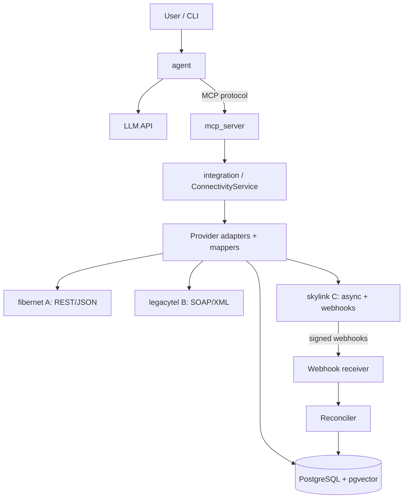

# Architecture

Phase 0 defines the boundaries; later phases fill in the components.



## Dependency rules (enforced by import-linter)

- `agent` never imports `mcp_server`; it speaks the MCP protocol.
- `mcp_server` imports `integration`, never `agent` or a provider package.
- `integration` never imports `agent`, `mcp_server` or provider packages; it reaches providers
  only over HTTP.
- Each provider package imports only `provider_common`.
- `evals` and `rag` may import what they need.

## Repository layout

Every top-level package is a uv workspace member with its own `pyproject.toml` and tests:

```
providers/{provider_common,fibernet,legacytel,skylink}/
integration/  mcp_server/  agent/  evals/  rag/
infra/terraform/  docs/  docker-compose.yml  Makefile  .github/workflows/
```

## Phase 0 decisions

Recorded in [docs/decisions](decisions/): project name, embeddings default, in-process MCP server,
Step Functions as a complement to the reconciler, and the default LLM model.

The order-creation sequence diagram (including the ambiguous-timeout path) is added in phase 1.
