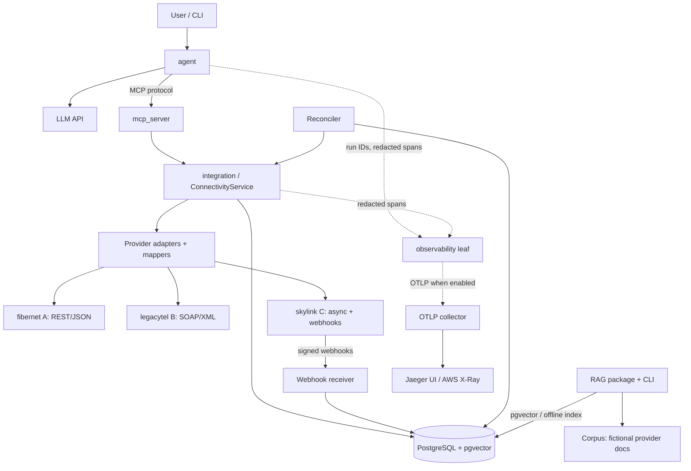
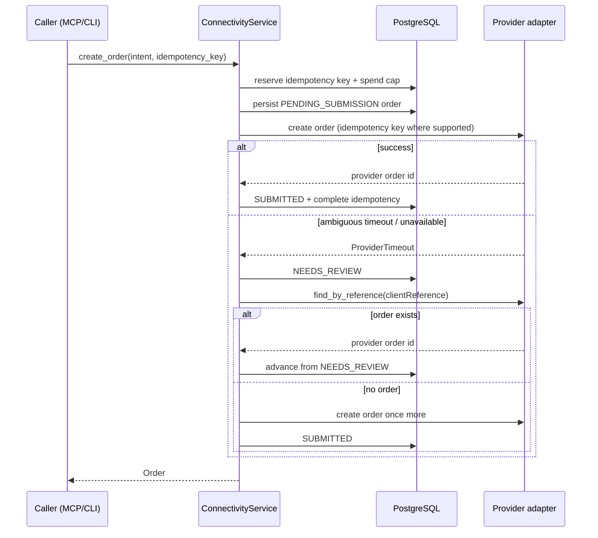
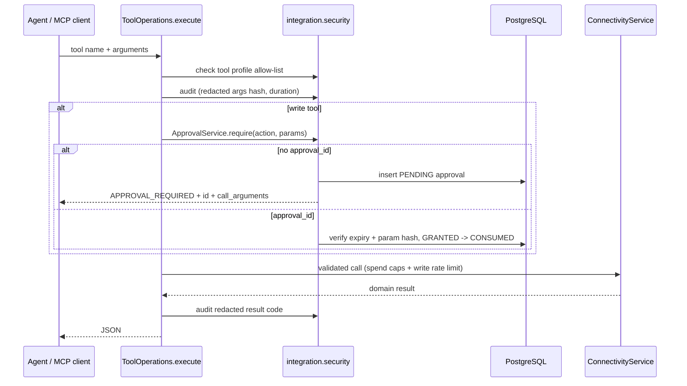
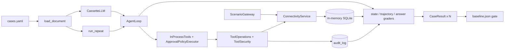
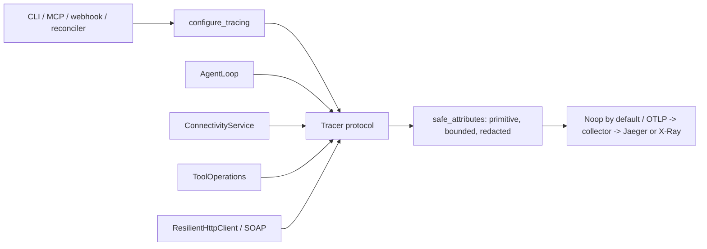
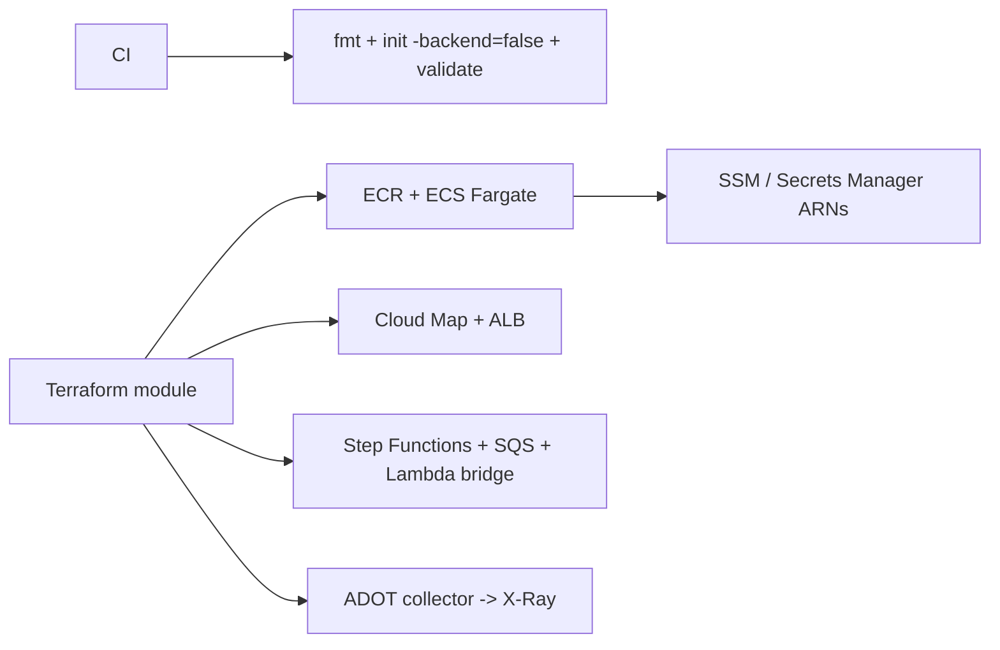

# Architecture

All seven phases are implemented: provider-facing boundaries, the hand-written agent, the MCP
boundary, hard security controls, deterministic evals, RAG, and finally AWS/Terraform, tracing and
a deterministic cost report.



## Dependency rules (enforced by import-linter)

- `agent` never imports `mcp_server`; it speaks the MCP protocol.
- `mcp_server` imports `integration`, never `agent` or a provider package.
- `integration` never imports `agent`, `mcp_server` or provider packages; it reaches providers
  only over HTTP/SOAP. Pure DTOs and mappers keep provider wire formats out of the domain.
- Each provider package imports only `provider_common`.
- `evals` imports the agent and integration layers, never the server or providers.
- `rag` is a leaf package: it imports no other workspace layer (enforced by import-linter), so
  retrieval can later be exposed by any layer without creating a dependency cycle.
- `observability` is another leaf: agent, integration, MCP server, webhook and reconciler may import
  it, but it imports no workspace layer. Provider packages cannot import it either, keeping the
  adapter boundary unchanged.
- `evals` imports the agent and integration layers to produce the cost-report input; the cost
  renderer itself lives in the leaf `observability` package and imports no eval code.

## Repository layout

Every top-level package is a uv workspace member with its own `pyproject.toml` and tests:

```
providers/{provider_common,fibernet,legacytel,skylink}/
integration/  mcp_server/  agent/  evals/  rag/  observability/
infra/terraform/  infra/otel/  infra/tests/  docs/  docker-compose.yml
Makefile  .github/workflows/
```

## Provider adapters

| Provider | Protocol | Eligibility | Order create | Reference lookup | Cancel |
| --- | --- | --- | --- | --- | --- |
| fibernet | FastAPI REST/JSON, bearer token, native idempotency key | sync, cacheable | `POST /v1/orders` | `GET /v1/orders?clientReference=` | yes |
| legacytel | Flask SOAP 1.1, Basic or WS-Security, no idempotency | sync, uncacheable | `PlaceOrder` | `FindOrdersByReference` | unsupported |
| skylink | Django/DRF REST, API key, signed webhooks | async poll, uncached | `POST /api/v2/orders` | `GET /api/v2/orders?clientReference=` | unsupported |

Adapters translate provider-specific money, timestamps, statuses and text into a single domain
model. Provider text is treated as untrusted and is never interpreted as an instruction.

## Resilience

Each logical provider call passes through a shared `ResilientHttpClient` that applies:

- a per-call timeout plus a bounded connect timeout;
- full-jitter retries for safe/idempotent operations only;
- a circuit breaker per provider, so a failing provider is failed fast;
- a concurrency semaphore, so one slow provider cannot exhaust the process;
- an audit sink that records one row per logical call with latency and outcome.

Writes are never blindly retried. The service persists the order as `PENDING_SUBMISSION` *before*
calling the provider. On an ambiguous timeout or transport failure it marks the order
`NEEDS_REVIEW`, looks it up by `clientReference`, and only re-submits when the provider confirms
no order exists (see the sequence diagram below).



## Webhooks and reconciliation

Skylink emits signed events from a transactional outbox. The receiver verifies the HMAC over
`timestamp + "." + raw_body` within a freshness window, stores the raw event with a unique
`(provider, event_id)` key, acknowledges duplicates, and only then applies the event to the
state machine. The state machine is rank-based: events are all recorded but never regress state.

The DB-driven reconciler is the authoritative convergence path because it does not depend on webhook
delivery. On each pass it processes every `NEEDS_REVIEW` order plus every non-terminal order older
than `RECONCILE_AFTER_S`, asks the provider for its current truth via `get_order` (falling back to
`find_by_reference`), and advances the local state. In production a Step Functions state machine
complements this loop (ADR 004).

## Agent loop (phase 2)

The CLI builds `AgentLoop` with an `LLMClient` and a `ToolExecutor`. The default LLM client wraps
`AsyncAnthropic`; tests and evals inject `ScriptedLLM`, so no key or network is needed. The loop is
an explicit while-loop with a step budget: one LLM response per step, each tool call executed in
sequence and its JSON result appended as a tool message. It returns an `AgentResult` containing the
answer, the full message history, per-tool traces (arguments, result, latency, error flag) and token
usage with an estimated cost.

The default `ToolExecutor` is `MCPToolExecutor`. It spawns `python -m aintegrator_mcp_server` over
stdio, calls `list_tools` once to build the model's tool schemas, and maps each loop call to
`call_tool`. The `FastMCP` server imports `integration` in-process (ADR 003); the agent never
imports the server package, so import-linter enforces the protocol boundary. The old
`InProcessTools` remains as a lightweight fallback for tests. Both executors delegate to
`integration.tooling.ToolOperations`, so validation, offer re-fetching, structured errors and the
phase 4 security policy have a single implementation.

## Security boundary (phase 4)

`ToolOperations.execute` is the one choke point for every tool call. It applies the policy object
from `integration.security` before touching the service:



Approvals are single-use, parameter-bound and expiring (ADR 007). The MCP server connects through
the least-privilege `aintegrator_mcp` role with no `DELETE`/`TRUNCATE` and append-only audit access
(ADR 008). `Redactor` scrubs secrets from both the audit row and the tool traces the model sees;
`--approve never|ask|auto` is enforced by an agent-side wrapper that can only grant tokens a human
has authorised. See [SECURITY.md](SECURITY.md) for the full threat model.

## Eval harness (phase 5)

`evals` is a separate workspace package that imports the agent and integration layers (never the
server or providers). For every case and every repeat it creates a fresh in-memory SQLite database,
a fresh set of `ScenarioGateway` provider replicas and a fresh `CassetteLLM`, then runs the *real*
`AgentLoop`, `InProcessTools`, `ApprovalPolicyExecutor` and `ToolOperations` — including the full
phase 4 policy. Only the LLM and provider transport are substituted, so the graded behaviour is
the production decision path.



`run_suite` repeats each case three times and `compute_metrics` derives task success, tool and
forbidden-action rates, approval compliance, duplicate-order and recovery rates, determinism,
steps, tokens, cost and latency percentiles. The CLI (`python -m aintegrator_evals`) exits non-zero
on a case failure or a stable-metric drift; see [EVALS.md](EVALS.md) and ADR 009.

## RAG pipeline (phase 6)

`rag` is a leaf workspace package. `load_corpus` parses four fictional markdown documents with
YAML front matter and `chunk_documents` splits them by heading into overlapping windows with stable
`doc_id::slug::position` IDs. An `Embedder` produces unit-length vectors: a deterministic hashing
default for CI and an optional local `BAAI/bge-small-en-v1.5` model (ADR 002). `InMemoryStore`
serves offline CLI/evals, while `PgVectorStore` binds parameters to pgvector cosine distance and a
generated `tsvector` column; both fuse dense and lexical rankings with the same RRF helper.

```mermaid
flowchart LR
    corpus[rag/corpus/*.md] --> Chunk[chunk_documents]
    Chunk --> Embed[Embedder: hash or BGE]
    Embed --> Store[InMemoryStore or PgVectorStore]
    Query[User question] --> Retrieve[Retriever]
    Retrieve --> Store
    Store --> Hits[dense / lexical / hybrid hits]
    Hits --> Answer[extractive answer + [n] citations]
    Hits --> Eval[14-query baseline gate]
```

Retrieved text is untrusted data: the answer path quotes snippets and renders a source list, and
the RAG package exposes no write tool. See [RAG.md](RAG.md) and ADR 010.

## Tracing (phase 7)

`observability` exposes a four-method `Tracer` protocol (`start_span`) and a matching `Span`
(`set_attribute`, `record_exception`, `set_status`). `NoopTracer` is the default, so a bare checkout
never opens a socket. `configure_tracing()` reads `OTEL_ENABLED` and, when the optional `otlp` extra
is installed, wires an OTLP gRPC exporter to `OTEL_EXPORTER_OTLP_ENDPOINT`. `OtelTracer` is the only
place that imports the SDK; callers pass plain dictionaries.



`AgentLoop.run` creates a UUID run ID in a `ContextVar`, resets it in `finally`, and decorates every
nested span with it. The `traced` decorator adds the same run ID to service and HTTP spans and marks
failures with `record_exception` + an error status. `trace_headers()` emits a W3C `traceparent` on
outbound HTTP when an OTLP span is live. Attribute names containing password/secret/token/key
fragments are dropped and long strings are truncated; tool arguments and results are never span
attributes. See ADR 011.

## Cost report (phase 7)

The eval runner adds per-run `profile`, `provider`, `tags` and token/cost `usage` plus a top-level
`config` block to `evals/reports/latest.json`. Machine-dependent latency is omitted from that file
so repeated runs are byte-identical. `aintegrator-cost-report` aggregates the runs into profile and
provider buckets, reports cost per run and a separate planning projection from
`COST_REPORT_DAILY_RUNS × COST_REPORT_DAYS`, and renders `docs/cost-report.md` with no timestamps or
host paths. `make cost-report-check` is a CI gate. No billing API, API key or running service is
involved; all rates are fictional. See ADR 012.

## AWS deployment (phase 7)

The Terraform module under `infra/terraform` mirrors the local stack: ECR repositories, an ECS
Fargate cluster with Cloud Map service discovery, a public ALB for the webhook, an EventBridge
scheduled reconciler, and a private namespace for provider endpoints. Credentials are passed as
SSM/Secrets Manager ARNs through `TF_VAR_*` and injected as ECS secrets; no literal secret appears
in HCL or tfvars. An ADOT collector receives OTLP on `4317`/`4318` and exports to X-Ray plus debug
logs. Step Functions runs the reconciler, waits on an SQS task token and falls back to another
reconciler task; a dependency-free Lambda bridge completes the token. The DB reconciler remains
authoritative (ADR 004). Public subnets, public IPs and HTTP are demo-only choices (ADR 013).



## Testing layers

- **Unit** (`make check`): no services, in-memory SQLite, fake gateways. Covers domain rules,
  mappers, resilience primitives, service idempotency, state-machine behavior, tool schemas, the
  agent loop, CLI wiring, eval harness (bindings, graders, baseline drift), RAG corpus,
  embedders, stores, rank fusion, tracing spans, cost aggregation and static Terraform layout.
- **Eval** (`make eval`): 34 YAML cases × 3 repeats over the real loop and tool boundary with
  cassettes and simulated providers; gates stable metrics and writes the deterministic JSON report.
- **Cost** (`make cost-report-check`): verifies the checked-in Markdown is reproducible from that
  report, with no API key or live cost API.
- **Terraform** (`make terraform-check` / `make terraform-validate`): static HCL/layout assertions
  locally; real `fmt`, `init -backend=false` and `validate` in CI.
- **Retrieval eval** (`make rag-eval`): rebuilds the offline index, then runs 14 queries × 3 modes;
  gates recall@5, MRR and nDCG@5 against `rag/retrieval_baseline.json`.
- **MCP protocol** (`mcp_server/tests`): in-memory client/server sessions cover tool discovery,
  schemas and the full order lifecycle; a stdio test runs against the live compose stack.
- **Scripted demo** (`make demo-agent`): the real loop and MCP transport against the live
  providers, driven by a scripted LLM, so CI exercises the agent without an API key.
- **Contract** (`make contract-test`): real adapters against the three simulated providers;
  checks wire formats, auth, malformed responses, rate limits and unsupported operations.
- **Integration** (`make integration-test`): real adapters plus webhook receiver and reconciler;
  checks signature rejection, dedupe, out-of-order events and recovery when every webhook is lost,
  and exercises pgvector ingestion plus all three retrieval modes against PostgreSQL 16.

## Decisions

Decisions 001–013 are recorded in [docs/decisions](decisions/).
