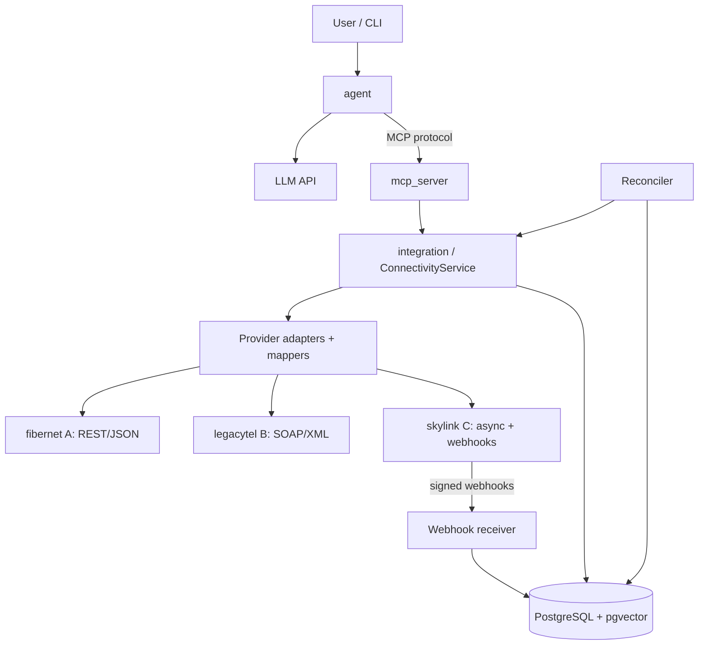
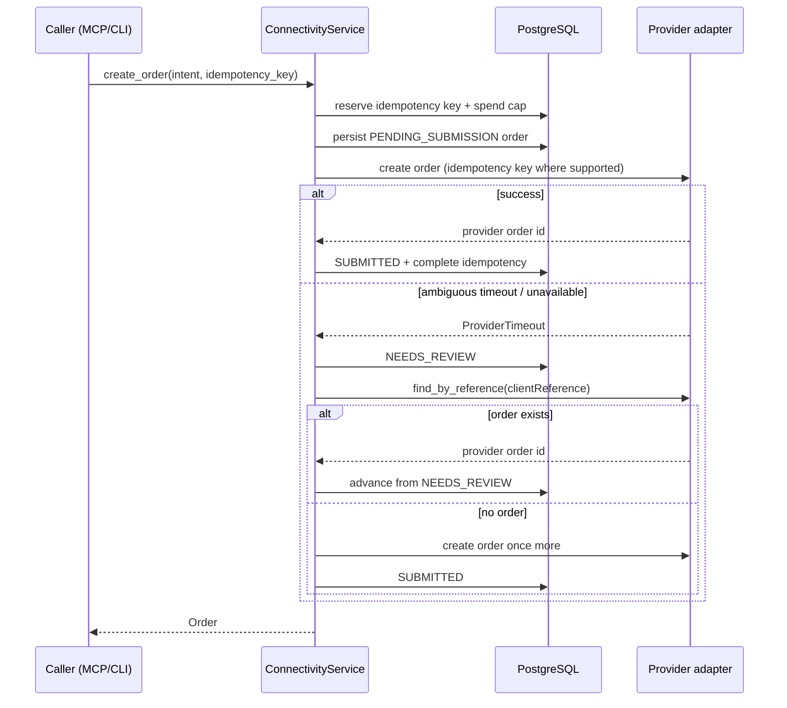

# Architecture

Phase 3 implements the provider-facing boundaries, the hand-written agent and the MCP boundary.
Later phases fill in hard security controls, evals, RAG and deployment.



## Dependency rules (enforced by import-linter)

- `agent` never imports `mcp_server`; it speaks the MCP protocol.
- `mcp_server` imports `integration`, never `agent` or a provider package.
- `integration` never imports `agent`, `mcp_server` or provider packages; it reaches providers
  only over HTTP/SOAP. Pure DTOs and mappers keep provider wire formats out of the domain.
- Each provider package imports only `provider_common`.
- `evals` and `rag` may import what they need.

## Repository layout

Every top-level package is a uv workspace member with its own `pyproject.toml` and tests:

```
providers/{provider_common,fibernet,legacytel,skylink}/
integration/  mcp_server/  agent/  evals/  rag/
infra/terraform/  docs/  docker-compose.yml  Makefile  .github/workflows/
```

## Provider adapters

| Provider | Protocol | Eligibility | Order create | Reference lookup | Cancel |
| --- | --- | --- | --- | --- | --- |
| fibernet | FastAPI REST/JSON, bearer token, native idempotency key | sync, cacheable | `POST /v1/orders` | `GET /v1/orders?clientReference=` | yes |
| legacytel | Flask SOAP 1.1, Basic or WS-Security, no idempotency | sync, uncacheable | `PlaceOrder` | `FindOrdersByReference` | unsupported |
| skylink | Django/DRF REST, API key, signed webhooks | async poll, uncached | `POST /api/v2/orders` | `GET /api/v2/orders?clientReference=` | unsupported |

Adapters translate provider-specific money, timestamps, statuses and text into a single domain
model. Provider text is treated as untrusted and is never interpreted as an instruction.

## Resilience

Each logical provider call passes through a shared `ResilientHttpClient` that applies:

- a per-call timeout plus a bounded connect timeout;
- full-jitter retries for safe/idempotent operations only;
- a circuit breaker per provider, so a failing provider is failed fast;
- a concurrency semaphore, so one slow provider cannot exhaust the process;
- an audit sink that records one row per logical call with latency and outcome.

Writes are never blindly retried. The service persists the order as `PENDING_SUBMISSION` *before*
calling the provider. On an ambiguous timeout or transport failure it marks the order
`NEEDS_REVIEW`, looks it up by `clientReference`, and only re-submits when the provider confirms
no order exists (see the sequence diagram below).



## Webhooks and reconciliation

Skylink emits signed events from a transactional outbox. The receiver verifies the HMAC over
`timestamp + "." + raw_body` within a freshness window, stores the raw event with a unique
`(provider, event_id)` key, acknowledges duplicates, and only then applies the event to the
state machine. The state machine is rank-based: events are all recorded but never regress state.

The DB-driven reconciler is the authoritative convergence path because it does not depend on webhook
delivery. On each pass it processes every `NEEDS_REVIEW` order plus every non-terminal order older
than `RECONCILE_AFTER_S`, asks the provider for its current truth via `get_order` (falling back to
`find_by_reference`), and advances the local state. In production a Step Functions state machine
complements this loop (ADR 004).

## Agent loop (phase 2)

The CLI builds `AgentLoop` with an `LLMClient` and a `ToolExecutor`. The default LLM client wraps
`AsyncAnthropic`; tests and evals inject `ScriptedLLM`, so no key or network is needed. The loop is
an explicit while-loop with a step budget: one LLM response per step, each tool call executed in
sequence and its JSON result appended as a tool message. It returns an `AgentResult` containing the
answer, the full message history, per-tool traces (arguments, result, latency, error flag) and token
usage with an estimated cost.

The default `ToolExecutor` is `MCPToolExecutor`. It spawns `python -m aintegrator_mcp_server` over
stdio, calls `list_tools` once to build the model's tool schemas, and maps each loop call to
`call_tool`. The `FastMCP` server imports `integration` in-process (ADR 003); the agent never
imports the server package, so import-linter enforces the protocol boundary. The old
`InProcessTools` remains as a lightweight fallback for tests. Both executors delegate to
`integration.tooling.ToolOperations`, so validation, offer re-fetching and structured errors have
a single implementation. Writes are *not* hard-gated yet: the system prompt asks the model to
request confirmation, while phase 4 adds the server-side approval gate.

## Testing layers

- **Unit** (`make check`): no services, in-memory SQLite, fake gateways. Covers domain rules,
  mappers, resilience primitives, service idempotency, state-machine behavior, tool schemas, the
  agent loop and CLI wiring.
- **MCP protocol** (`mcp_server/tests`): in-memory client/server sessions cover tool discovery,
  schemas and the full order lifecycle; a stdio test runs against the live compose stack.
- **Scripted demo** (`make demo-agent`): the real loop and MCP transport against the live
  providers, driven by a scripted LLM, so CI exercises the agent without an API key.
- **Contract** (`make contract-test`): real adapters against the three simulated providers;
  checks wire formats, auth, malformed responses, rate limits and unsupported operations.
- **Integration** (`make integration-test`): real adapters plus webhook receiver and reconciler;
  checks signature rejection, dedupe, out-of-order events and recovery when every webhook is lost.

## Decisions

Phase 0 and 1 decisions are recorded in [docs/decisions](decisions/).
